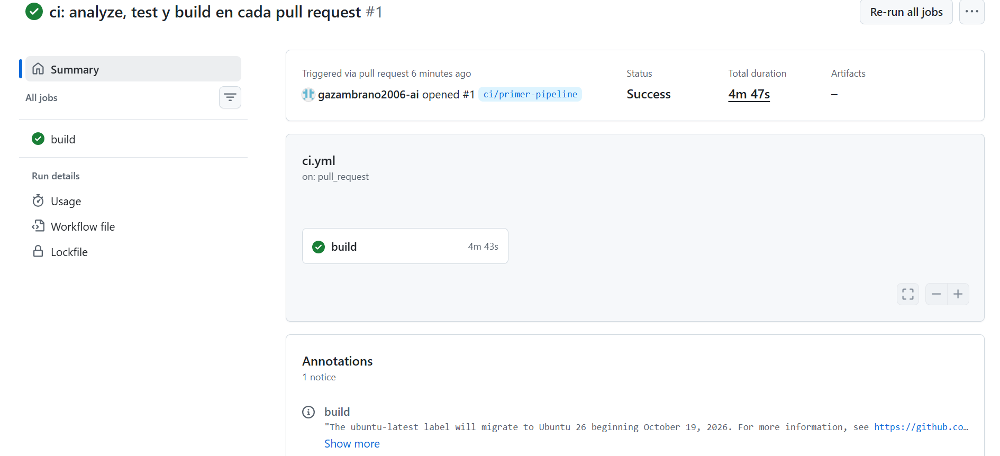
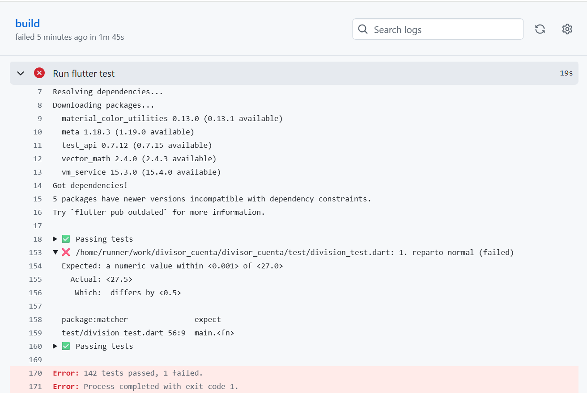
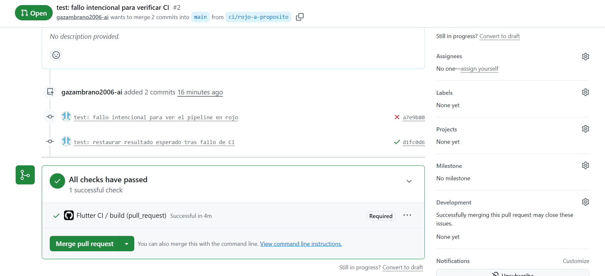
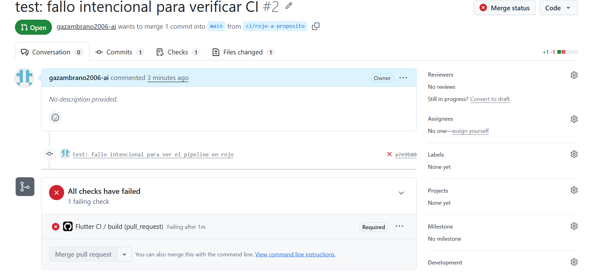
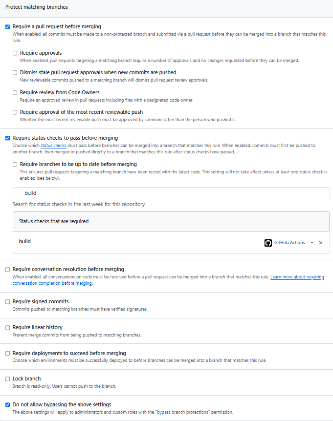
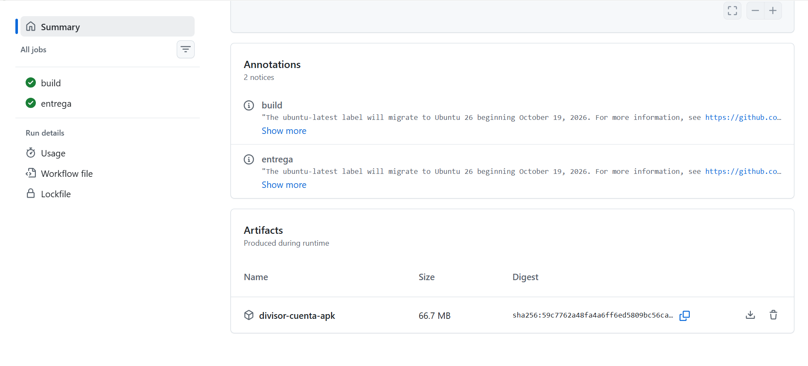

# Deber 4 — De TDD a CI/CD

## 1. Workflow de CI

El archivo `.github/workflows/ci.yml` quedó así:

```yaml
name: Flutter CI

on:
  push:
    branches: [main]
  pull_request:

jobs:
  build:
    runs-on: ubuntu-latest
    steps:
      - uses: actions/checkout@v6
      - uses: subosito/flutter-action@v2
        with:
          channel: stable
      - run: flutter pub get
      - run: flutter analyze
      - run: flutter test
      - run: flutter build apk --debug

  entrega:
    needs: build
    if: ${{ github.event_name == 'push' && github.ref == 'refs/heads/main' && needs.build.result == 'success' }}
    runs-on: ubuntu-latest
    steps:
      - uses: actions/checkout@v6
      - uses: subosito/flutter-action@v2
        with:
          channel: stable
      - run: flutter pub get
      - run: flutter build apk --debug
      - uses: actions/upload-artifact@v7
        with:
          name: divisor-cuenta-apk
          path: build/app/outputs/flutter-apk/app-debug.apk
```

- **Analyze:** revisa el código y detecta problemas mediante el analizador de Dart.
- **Test:** ejecuta las pruebas automáticas para comprobar el comportamiento de la aplicación.
- **Build:** compila la aplicación y comprueba que puede generar un APK de Android.

El job `entrega` depende de `build` y solamente se ejecuta después de un push a `main`, si las verificaciones anteriores terminaron correctamente.



## 2. Fallo detectado por el pipeline

Para comprobar el funcionamiento de CI cambié intencionalmente el resultado esperado del primer escenario en `test/casos_de_prueba.dart`, de `27.50` a `27.00`.

El pipeline falló en `flutter test`. En el registro, la línea 153 identificó la prueba `test/division_test.dart: 1. reparto normal (failed)`. Después, la línea 170 mostró `Error: 142 tests passed, 1 failed`, y la línea 171 indicó que el proceso terminó con código de salida 1.

Esto demostró que GitHub Actions detectaba una diferencia entre el resultado esperado y el que realmente calculaba el programa.



Después restauré el valor `27.50` en el mismo Pull Request. Las 143 pruebas volvieron a pasar y el pipeline terminó correctamente.



## 3. Diferencias entre CI, Continuous Delivery y Continuous Deployment

- **Continuous Integration (CI):** ejecuta automáticamente verificaciones cuando se envían cambios, para detectar problemas antes de unirlos al proyecto principal.
- **Continuous Delivery:** además de verificar, deja una versión de la aplicación preparada y disponible para su entrega.
- **Continuous Deployment:** publica automáticamente los cambios en producción cuando pasan las verificaciones, sin requerir una aprobación manual adicional.

En este deber implementé CI y una forma básica de Continuous Delivery. GitHub ejecuta el análisis, las pruebas y la compilación. Después de un push a `main`, el job `entrega` genera un APK y lo publica como artifact descargable.

No implementé Continuous Deployment porque la aplicación no se publica automáticamente para usuarios finales. Además, el APK generado es de depuración.

## 4. Protección de la rama main

Configuré GitHub para exigir un Pull Request y que el check `build` pase antes de permitir la fusión.

Cuando cambié intencionalmente la prueba, GitHub mostró `All checks have failed` y deshabilitó el botón `Merge pull request`.

Esto evita que se fusionen a `main` cambios cuyas verificaciones obligatorias están fallando. No garantiza que el programa esté libre de todos los errores, pero reduce el riesgo de incorporar cambios que rompan pruebas existentes.



La configuración también quedó documentada:



## 5. Revisión crítica del agente

Le pedí a Codex que revisara los riesgos de seguridad y fragilidad del archivo `ci.yml`, sin modificarlo.

El agente señaló que las acciones utilizan etiquetas que pueden cambiar, que no declaramos permisos explícitos para `GITHUB_TOKEN`, que Flutter estable puede actualizarse y que `upload-artifact` podría no fallar cuando no encuentre el APK.

**La sugerencia que acepté como mejora recomendable** fue agregar `if-no-files-found: error`, porque permitiría detectar una entrega incompleta en lugar de dejar únicamente una advertencia. No la apliqué en este deber, ya que la actividad pedía una revisión crítica y el pipeline actual había generado correctamente el APK.

**La sugerencia que decidí no aplicar en este ejercicio** fue fijar una versión exacta de Flutter. Reconozco que mejoraría la reproducibilidad, pero preferí conservar la versión estable solicitada y no agregar cambios innecesarios.

También considero útil aplicar permisos mínimos y revisar las versiones de las acciones en un proyecto más grande.

## 6. ¿Qué garantiza realmente un CI verde?

Un CI verde significa que las verificaciones configuradas terminaron correctamente en el entorno donde se ejecutaron. En nuestro caso, indica que el análisis no reportó problemas, las pruebas pasaron y la aplicación pudo compilarse.

Sin embargo, no garantiza que el programa funcione perfectamente en todas las situaciones.

Por ejemplo, la aplicación podría tener un problema visual en un celular con una pantalla muy pequeña y aun así pasar todas las pruebas, si ninguna comprueba ese tamaño de pantalla.

Por eso las pruebas automáticas son importantes, pero no sustituyen completamente las revisiones y pruebas manuales.

## 7. ¿Qué detectó el pipeline que yo no había visto?

El pipeline detectó automáticamente que el primer escenario tenía un resultado esperado incorrecto. Aunque provoqué ese error intencionalmente, GitHub logró identificar la prueba afectada, marcar el workflow como fallido y bloquear la fusión a `main`.

También comprobé que, después de corregir el valor en el mismo Pull Request, las verificaciones volvieron a pasar sin modificar la lógica de la aplicación.

No apareció otro error inesperado durante las ejecuciones correctas. Sí aparecieron avisos informativos relacionados con el entorno Ubuntu, pero no impidieron la compilación.

## Evidencia de entrega del APK

Después de fusionar el Pull Request de la entrega automática, GitHub ejecutó los jobs `build` y `entrega` correctamente y publicó el artifact `divisor-cuenta-apk`, de aproximadamente 66,7 MB.

