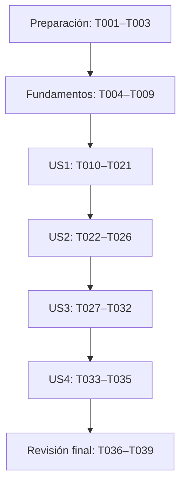

# Tareas: Dividir la cuenta de un restaurante

**Entrada**: documentos de `specs/001-dividir-cuenta/`.
**Rama actual**: `sdd` | **Fecha**: 2026-10-01.

**Referencias**: [especificación](spec.md), [plan](plan.md),
[investigación](research.md), [modelo](data-model.md),
[contratos internos](contracts/contratos-internos.md),
[contrato de pantalla](contracts/interfaz-pantalla.md) y
[guía de validación](quickstart.md).

**Pruebas**: se incluyen tareas de pruebas porque la
[Constitución](../../.specify/memory/constitution.md), principio IV, exige que
la funcionalidad crítica tenga pruebas y que los criterios de aceptación se
conviertan en pruebas ejecutables.

**Alcance de esta fase**: generar únicamente este documento. Ninguna tarea está
ejecutada; la aplicación permanece sin implementar.

## Formato y condiciones de ejecución

- Cada tarea tiene casilla, ID consecutivo, descripción y rutas relativas a la
  raíz del proyecto Flutter. `[US1]` a `[US4]` identifican las historias de la
  especificación; todas tienen prioridad P1.
- `[P]` indica trabajo sobre archivos distintos que puede hacerse en paralelo
  después de completar sus prerrequisitos. Las tareas sin esa marca se ejecutan
  en el orden indicado o tras las dependencias expresas.
- Antes de ejecutar cualquier tarea que cree o modifique `test/`, incluida la
  sustitución de la prueba del contador, debe existir autorización del usuario.
  [AGENTS.md](../../AGENTS.md) dice: **"No modificar `test/` sin autorización del
  usuario."** Enumerar estas tareas no concede esa autorización.
- Mantener el proyecto y repositorio existentes, SDK estable, null safety y
  nombres propios en español. No agregar paquetes externos ni modificar
  `android/` o `ios/`. Las únicas dependencias directas previstas son Flutter y
  `flutter_test` del SDK; sus dependencias transitivas las resuelve el SDK.
- La composición de dependencias de producción estará en `lib/main.dart`.
  Los valores `Cuenta` y `Resultado` se crean durante cada operación, y las
  instancias usadas por pruebas pertenecen a su arnés, según el plan.

## Fase 1: Preparación del proyecto existente

**Objetivo**: preparar estructura y dependencias sin crear otro proyecto ni
repositorio.

- [ ] T001 Verificar el SDK estable con `flutter --version` y preparar `lib/domain/`, `lib/data/` y `lib/presentation/` en el proyecto actual; conservar la restricción de versión del SDK en `pubspec.yaml` y las carpetas nativas, sin ejecutar `flutter create` ni inicializar Git.
- [ ] T002 Retirar `cupertino_icons` y `flutter_lints` de `pubspec.yaml` y el include `package:flutter_lints/flutter.yaml` de `analysis_options.yaml`; conservar Flutter y `flutter_test` del SDK y el análisis de `lib/` y `test/`, sin agregar dependencias externas ni silenciar errores.
- [ ] T003 Ejecutar `flutter pub get` desde la raíz de `pubspec.yaml`, actualizar `pubspec.lock` y verificar que las dependencias directas sean solo las previstas del SDK; no usar `flutter pub upgrade` para ampliar el alcance.

**Punto de control**: estructura preparada y dependencias resueltas; no hay
paquetes externos directos ni referencias de análisis a paquetes retirados.

## Fase 2: Fundamentos compartidos

**Objetivo**: definir los valores, contratos y validación que requieren todas las
historias. Esta fase depende de T001–T003 y bloquea su integración.

- [ ] T004 [P] Crear `Cuenta` inmutable en `lib/domain/cuenta.dart`, sin validación, cálculo ni formato en el constructor: `montoCoeficiente` (`BigInt`), "Cifras del monto sin punto; mayor o igual que cero."; `montoEscala` (`int`), "Cantidad de cifras decimales del monto; mayor o igual que cero."; `personas` (`BigInt`), "Número de personas; entero mayor o igual que uno."; `propinaCoeficiente` (`BigInt`), "Cifras del porcentaje sin punto; mayor o igual que cero."; `propinaEscala` (`int`), "Cantidad de cifras decimales del porcentaje; mayor o igual que cero.".
- [ ] T005 [P] Crear `Resultado` inmutable en `lib/domain/resultado.dart` con `centavosPorPersona` (`BigInt`): "Importe individual final, no negativo, después de aplicar la estrategia."; conservar solo el valor numérico, sin texto ni errores de entrada.
- [ ] T006 [P] Crear la interfaz abstracta `EstrategiaRedondeo` en `lib/domain/estrategia_redondeo.dart` con el único método `BigInt redondear(BigInt numerador, BigInt denominador)`; contrato: numerador no negativo, denominador positivo y salida en centavos no negativos, sin Flutter ni métodos adicionales.
- [ ] T007 Definir únicamente los alias de función `ValidacionEntrada` y `DivisionCuenta` en `lib/domain/contratos_divisor.dart`: tres textos devuelven una `Cuenta` válida y, ante entradas inválidas, lanzan `ArgumentError` con `message` de tipo `String`; una `Cuenta` válida y una `EstrategiaRedondeo` devuelven `Resultado`; depende de T004–T006.
- [ ] T008 Escribir pruebas de `ValidarEntrada` en `test/domain/validar_entrada_test.dart`: análisis decimal exacto con punto y espacios externos, conservación de cifras, una persona y monto cero válidos; monto vacío/no numérico/negativo/NaN/infinito → `Monto inválido`; personas cero/negativas → `Debe haber al menos una persona`; personas vacías/no numéricas/fraccionarias y propina vacía/no numérica/negativa/no finita → sus mensajes de contrato; comprobar `ArgumentError.message`, orden monto → personas → propina y ausencia de límites máximos arbitrarios.
- [ ] T009 Implementar `ValidarEntrada.ejecutar` y sus ayudantes de análisis en `lib/domain/validar_entrada.dart` para hacer pasar T008: conservar coeficientes y escalas sin `double` ni redondeo previo; analizar personas como entero base diez; crear `Cuenta` solo tras validar los tres textos, con `Número de personas inválido` y `Propina inválida` para los errores adicionales; no importar Flutter ni paquetes externos.

**Punto de control**: modelos y contratos estables; la validación protege al
cálculo y cumple los mensajes obligatorios. Las pruebas de T008 deben pasar antes
de integrar la pantalla. No se necesitan pruebas que solo repitan asignaciones
de constructores de los valores inmutables.

## Fase 3: US1 — Calcular el pago de cada persona (P1, primer incremento)

**Objetivo**: cuenta con propina, división igual, modo Exacto y resultado de dos
decimales en una pantalla. La validación compartida ya está disponible.

**Prueba independiente**: CA-001 `100.00 / 4 / 10% → 27.50`, CA-002
`90.00 / 3 / 0% → 30.00` y CA-005 `10.00 / 3 / 0% → 3.33`, todos en Exacto.
No hay resultado inicial ni cálculo al editar; una persona y monto cero son válidos.

### Pruebas antes de la implementación de la historia

- [ ] T010 [P] [US1] Crear `test/domain/calcular_division_test.dart` con valores esperados de CA-001, CA-002 y CA-005, propina decimal y división para una persona/monto cero; usar una estrategia de prueba para comprobar que `CalcularDivision` entrega la fracción sin redondeo intermedio y respeta los centavos devueltos, sin duplicar la fórmula del código en las expectativas.
- [ ] T011 [P] [US1] Crear `test/data/redondeo_exacto_test.dart` para el contrato de fracción a centavos: `10/3 → 333`, `1005/1000 → 101`, cero y valor entero; comprobar centavo más cercano, empate superior y ausencia de redistribución de sobrantes.
- [ ] T012 [P] [US1] Crear `test/presentation/formateador_moneda_test.dart` para `27.50`, `30.00`, `3.33`, `4.00`, `0.00`, una fracción de centavos con cero inicial y un importe grande sin notación científica; el formateador recibe centavos finales y no redondea.
- [ ] T013 [P] [US1] Crear `test/presentation/divisor_controller_test.dart` con dependencias de prueba recibidas por constructor: invocación de validar → calcular → formatear, selección por clave y opciones obtenidas del registro; comprobar salida `({String? resultado, String? error})` válida con resultado no nulo y error nulo, sin depender de clases de data.
- [ ] T014 [P] [US1] Sustituir, una vez autorizado, la prueba del contador en `test/widget_test.dart` por CA-001, CA-002 y CA-005 usando la composición de `lib/main.dart`; comprobar tres entradas, botón `Calcular`, ausencia inicial de resultado, cálculo solo al pulsar, pago por persona con dos cifras y casos de una persona/monto cero.

### Implementación

- [ ] T015 [P] [US1] Implementar `CalcularDivision.ejecutar` en `lib/domain/calcular_division.dart`: calcular la fracción exacta de `monto × (1 + propina/100) / personas` con los coeficientes y escalas de `Cuenta`, llamar al método de `EstrategiaRedondeo` y crear `Resultado`; no validar, formatear, convertir a `double` ni comprobar tipos concretos; depende de T010.
- [ ] T016 [P] [US1] Implementar `RedondeoExacto` en `lib/data/redondeo_exacto.dart` mediante cociente entero y residuo de `100 × numerador / denominador`; incrementar el centavo cuando el doble del residuo sea mayor o igual que el denominador; cumplir T011 y las precondiciones comunes, sin formato ni validación de entradas.
- [ ] T017 [P] [US1] Implementar `FormateadorMoneda.formatear` en `lib/presentation/formateador_moneda.dart` separando unidades y residuo de cien centavos, con punto y relleno de dos cifras; cumplir T012 sin redondear ni convertir a `double`.
- [ ] T018 [US1] Implementar `DivisorController` en `lib/presentation/divisor_controller.dart` con `ValidacionEntrada`, `DivisionCuenta`, `FormateadorMoneda` y registro inmutable `Map<String, EstrategiaRedondeo>` recibidos por constructor; exponer sus opciones y orquestar el camino válido conforme a T013, sin construir colaboradores ni importar data; depende de T015–T017.
- [ ] T019 [US1] Implementar `PantallaDivisor` en `lib/presentation/pantalla_divisor.dart` como `StatefulWidget` que recibe el controlador: campos `Monto total`, `Número de personas`, `Propina (%)`, selector derivado del registro y botón `Calcular`; conservar `String monto`, `String personas`, `String propina`, `String modo`, `String? resultado` y `String? error`, inicialmente sin salida; calcular fuera del callback de `setState` y aplicar juntos los campos de salida; depende de T018.
- [ ] T020 [US1] Reemplazar el contador en `lib/main.dart` por la composición del primer incremento: construir validador, cálculo, `RedondeoExacto`, formateador, controlador y pantalla; pasar referencias a métodos con los contratos de domain y registrar `Exacto`; el registro se ampliará en US3 sin editar las clases existentes; depende de T019.
- [ ] T021 [US1] Ejecutar `flutter test test/domain test/data test/presentation test/widget_test.dart` y verificar los criterios independientes de US1 en `test/widget_test.dart`; exigir CA-001, CA-002 y CA-005 correctos y pruebas unitarias verdes antes de continuar.

**Punto de control**: el incremento de cálculo Exacto funciona. Todavía se deben
completar US2–US4 para satisfacer toda la especificación.

## Fase 4: US2 — Identificar entradas inválidas (P1)

**Objetivo**: presentar el error de entrada sin conservar un pago anterior y
permitir corregir y volver a calcular. La validación y mensajes ya existen en T009.

**Prueba independiente**: CA-003 `50.00 / 0 / 0%` muestra exactamente
`Debe haber al menos una persona`; CA-004 `abc / 3 / 0%` muestra exactamente
`Monto inválido`. Ambos casos carecen de resultado, antes y después de un cálculo
válido. Corregir los datos permite recuperar el pago en la misma pantalla.

### Pruebas

- [ ] T022 [P] [US2] Ampliar `test/presentation/divisor_controller_test.dart` para los errores de entrada de T008: salida con error y resultado nulo, textos exactos sin el prefijo de `ArgumentError`, sin llamar al cálculo ni al formateador tras validación fallida y recuperación con datos válidos en una llamada posterior.
- [ ] T023 [P] [US2] Ampliar `test/widget_test.dart` con CA-003 y CA-004 antes y después de CA-001; comprobar desaparición de `27.50`, mensajes exactos y ausencia de cualquier resultado; cubrir también personas negativas/vacías/no numéricas/fraccionarias, monto vacío/negativo/no finito, propina inválida y corrección seguida de Calcular.

### Implementación

- [ ] T024 [P] [US2] Completar el manejo de error de entrada en `lib/presentation/divisor_controller.dart`: capturar solo los `ArgumentError` de la validación y entregar su mensaje y resultado nulo, sin ocultar errores de programación del cálculo o del registro; garantizar "un cálculo válido tiene solo resultado; uno inválido tiene solo error."; depende de T022.
- [ ] T025 [P] [US2] Completar en `lib/presentation/pantalla_divisor.dart` la presentación excluyente de error y resultado: en cada cálculo inválido asignar resultado nulo, en cada válido error nulo, manteniendo editables los campos y la recuperación mediante Calcular; depende de T023 y del contrato ya estable del controlador de US1.
- [ ] T026 [US2] Ejecutar las pruebas de `test/domain/validar_entrada_test.dart`, `test/presentation/divisor_controller_test.dart` y `test/widget_test.dart`; exigir CA-003/CA-004, recuperación y los casos válidos de US1 correctos; depende de T024 y T025.

**Punto de control**: error y pago nunca aparecen simultáneamente, y los casos
inválidos no conservan resultados previos.

## Fase 5: US3 — Elegir el redondeo hacia arriba (P1)

**Objetivo**: añadir Hacia arriba mediante una nueva implementación y su registro
en la composición, manteniendo las clases existentes.

**Prueba independiente**: CA-006 `10.00 / 3 / 0% → 4.00`; con esos mismos datos,
calcular en Exacto, Hacia arriba y Exacto produce `3.33 → 4.00 → 3.33`.
`90.00 / 3 / 0%` permanece `30.00`, y `3.001 / 1 / 0%` produce `4.00`.

### Pruebas

- [ ] T027 [P] [US3] Crear `test/data/redondeo_hacia_arriba_test.dart`: `10/3 → 400` centavos, `90/3 → 3000`, `3001/1000 → 400` y cero; comprobar techo del cociente original, entero que no aumenta y las mismas precondiciones/salida que Exacto.
- [ ] T028 [P] [US3] Ampliar `test/presentation/divisor_controller_test.dart` para elegir dos estrategias por sus claves y sustituirlas por una implementación de prueba del mismo contrato; verificar delegación y opciones derivadas del registro sin comprobar tipos ni añadir un tercer modo a la aplicación.
- [ ] T029 [P] [US3] Ampliar `test/widget_test.dart` con CA-006, alternancia Exacto → Hacia arriba → Exacto con pulsación del botón en cada paso, entero que no aumenta, cociente `3.001`, una persona y monto cero en Hacia arriba; cambiar solo el selector no debe recalcular.

### Implementación

- [ ] T030 [US3] Implementar `RedondeoHaciaArriba` en `lib/data/redondeo_hacia_arriba.dart`: obtener cociente entero y residuo de la fracción original, elevar solo cuando el residuo sea positivo y devolver el entero multiplicado por cien; cumplir T027 sin validar ni formatear.
- [ ] T031 [US3] Construir y registrar `RedondeoHaciaArriba` con clave `Hacia arriba` en el mapa inmutable de `lib/main.dart`, manteniendo `Exacto`; no modificar `CalcularDivision`, `DivisorController`, `PantallaDivisor`, `FormateadorMoneda` ni la interfaz para agregar esta regla; depende de T030.
- [ ] T032 [US3] Ejecutar `flutter test` sobre `test/domain/`, `test/data/`, `test/presentation/` y `test/widget_test.dart`; exigir CA-001 a CA-006 correctos, ambos modos sustituibles y alternancia sin regresiones; depende de T031.

**Punto de control**: los dos modos funcionan y los seis escenarios originales
están convertidos en pruebas ejecutables.

## Fase 6: US4 — Dividir la cuenta sin conexión (P1)

**Objetivo**: comprobar que apertura, entrada, validación y cálculo funcionan sin
servicios externos. No se crea una función de conectividad para demostrarlo.

**Prueba independiente**: abrir una compilación instalada en un dispositivo sin
conexión y repetir CA-001 a CA-006 con las mismas salidas: `6 de 6` correctos.

### Pruebas y verificación

- [ ] T033 [P] [US4] Crear `test/presentation/funcionamiento_sin_conexion_test.dart` con `flutter_test` del SDK: iniciar la aplicación mediante la composición de `lib/main.dart`, bloquear intentos HTTP con el arnés de pruebas del SDK y ejecutar CA-001 a CA-006 comprobando apertura, entrada, selección, resultados y errores; no permitir que la prueba use red real ni agregar paquetes de integración.
- [ ] T034 [P] [US4] Auditar `lib/main.dart`, `lib/domain/`, `lib/data/`, `lib/presentation/` y `pubspec.yaml` para confirmar ausencia de clientes de red, sockets, peticiones, bases de datos, persistencia y credenciales; cualquier corrección se limita al código Dart de la funcionalidad, sin agregar servicios ni cambiar `android/` o `ios/`.
- [ ] T035 [US4] Tras T033 y T034, ejecutar la prueba sin conexión, preparar una compilación con las herramientas del SDK y abrirla instalada en un dispositivo ya sin conexión; repetir CA-001 a CA-006, incluyendo inicio desde la aplicación cerrada, y registrar destino, casos y resultados `6 de 6` en `specs/001-dividir-cuenta/quickstart.md`; no depender de descargar o compilar después de desconectar ni de cargar una web desde un servidor remoto.

**Punto de control**: la prueba automatizada y la comprobación en dispositivo
respaldan SC-004; la operación no depende de red ni almacenamiento.

## Fase 7: Revisión transversal y verificación final

**Objetivo**: comprobar la Constitución, la explicación de funciones y los
comandos acordados sobre la implementación completa. Depende de US1–US4.

- [ ] T036 Completar comentarios de explicación en las funciones necesarias de `lib/domain/`, `lib/data/`, `lib/presentation/` y `lib/main.dart`: qué hacen, por qué existen, entradas, salidas y errores; contrastar con `specs/001-dividir-cuenta/contracts/contratos-internos.md` para que el estudiante pueda explicarlas, sin introducir funciones adicionales.
- [ ] T037 Revisar SOLID e imports de `lib/domain/`, `lib/data/`, `lib/presentation/` y `lib/main.dart`: domain solo Dart, `presentation → domain ← data`, servicios concretos construidos solo en main, estrategia con un método, cálculo sin validación/formato y registro extensible sin comprobaciones de tipo; confirmar que no se guardaron secretos y que `android/` e `ios/` no cambiaron.
- [ ] T038 Formatear el código autorizado de `lib/` y `test/` con `dart format lib test` y verificar consistencia de null safety y nombres propios en español, conservando los nombres de APIs y overrides de Flutter; no ampliar el alcance a las carpetas nativas.
- [ ] T039 Ejecutar desde la raíz de `pubspec.yaml` los comandos `flutter pub get`, `flutter run`, `flutter analyze` y `flutter test`; comprobar la pantalla completa, análisis sin errores, pruebas correctas y los indicadores SC-001 a SC-005 según `specs/001-dividir-cuenta/quickstart.md`, registrando resultados reales y cualquier limitación del entorno sin declarar verificaciones no realizadas.

**Criterio de finalización**: 39 tareas completadas con autorización aplicable,
seis casos correctos, errores sin resultado, dos decimales, ambos modos y uso sin
conexión. El estado actual de esta lista es pendiente, no una afirmación de
pruebas ejecutadas.

## Dependencias y orden de ejecución

Las cuatro historias tienen P1; se conserva el orden de la especificación.
US2 utiliza la pantalla de US1; US3 integra el segundo modo sobre ese flujo ya
validado; US4 comprueba los seis casos integrados. Cada historia tiene criterios
propios para probarse una vez satisfechos sus prerrequisitos.

### Dependencias dentro de las fases

- T001 → T002 → T003. T004, T005 y T006 pueden realizarse juntos después de T003;
  T007 espera los tres; T008 precede a T009.
- En US1, escribir T010–T014 antes de implementar la historia. T015, T016 y T017
  pueden desarrollarse juntos con sus contratos y pruebas disponibles. Luego
  T018 → T019 → T020 → T021. Las pruebas que usan la composición completa se
  ejecutan al terminar T020, sin crear dependencias concretas en presentation.
- En US2, T022 y T023 pueden escribirse juntos. T024 y T025 pueden desarrollarse
  juntos sobre el contrato del controlador ya definido; T026 espera a ambos.
- En US3, T027–T029 pueden escribirse juntos; luego T030 → T031 → T032.
- En US4, T033 y T034 pueden ejecutarse juntos después de T032; T035 espera ambos.
- T036 → T037 → T038 → T039. Si una verificación falla, corregir el código
  correspondiente y repetir las comprobaciones afectadas antes de darla por hecha.

Las tareas de pruebas se ejecutan solo cuando exista autorización para `test/`.
Dentro de cada historia, escribir primero los casos, comprobar su fallo antes
de completar el comportamiento y exigir que pasen al integrar. Un error de
compilación mientras faltan archivos no acredita un criterio de aceptación.

## Ejemplos de ejecución paralela por historia

| Historia | Trabajo que puede repartirse | Condición y posterior integración |
|---|---|---|
| US1 | T010 en `test/domain/calcular_division_test.dart`, T011 en `test/data/redondeo_exacto_test.dart`, T012 en `test/presentation/formateador_moneda_test.dart`, T013 en `test/presentation/divisor_controller_test.dart` y T014 en `test/widget_test.dart`. Después, T015/T016/T017 en tres archivos de producción distintos. | Fundamentos terminados y autorización de pruebas. Integrar controlador, pantalla y main en T018–T020. |
| US2 | T022 y T023 en archivos de pruebas distintos; después T024 en `lib/presentation/divisor_controller.dart` y T025 en `lib/presentation/pantalla_divisor.dart`. | US1 validada y contrato del controlador estable. T026 verifica juntos manejo de error y vista. |
| US3 | T027 en `test/data/redondeo_hacia_arriba_test.dart`, T028 en `test/presentation/divisor_controller_test.dart` y T029 en `test/widget_test.dart`. | US2 integrada. T030 y T031 se mantienen secuenciales porque el registro requiere la nueva implementación. |
| US4 | T033 en `test/presentation/funcionamiento_sin_conexion_test.dart` y T034 sobre el código de producción y dependencias. | US3 validada. Cualquier corrección de T034 debe terminar antes de la comprobación T035. |

`test/widget_test.dart`, `test/presentation/divisor_controller_test.dart` y
`lib/main.dart` son compartidos entre historias: no ejecutar simultáneamente
las tareas de distintas fases que los modifican. `[P]` no elimina esos límites.

## Trazabilidad de aceptación

| Caso o resultado | Pruebas previstas | Integración y comprobación |
|---|---|---|
| CA-001: `27.50` | T010, T014 | T015–T021; repetición sin conexión T033/T035. |
| CA-002: `30.00` | T010, T014 | T015–T021; repetición sin conexión T033/T035. |
| CA-003: mensaje de personas, sin resultado | T008, T022, T023 | T009, T024–T026; repetición sin conexión T033/T035. |
| CA-004: `Monto inválido`, sin resultado | T008, T022, T023 | T009, T024–T026; repetición sin conexión T033/T035. |
| CA-005: `3.33` | T010, T011, T014 | T015–T021; alternancia T029/T032 y sin conexión T033/T035. |
| CA-006: `4.00` | T027, T029 | T030–T032; repetición sin conexión T033/T035. |
| SC-001 y SC-002: 6/6 y dos cifras | T012, T014, T023, T029 | T032 y verificación final T039. |
| SC-003: errores ocultan el resultado previo | T022, T023 | T024–T026. |
| SC-004: 6/6 sin conexión | T033 | T034 y T035. |
| SC-005: todo en una pantalla | T014, T023, T029 | T019, T025 y T039. |

FR-001 a FR-007 quedan cubiertos por US1 y US3; FR-008 a FR-011 por la validación
compartida y US2; FR-012 por US4. Los empates, cero monto, una persona, enteros en
Hacia arriba, recuperación y falta de red verifican reglas existentes.

## Estrategia de implementación incremental

1. Preparar el proyecto y completar los fundamentos, con la autorización de
   pruebas verificada antes de tocar `test/`.
2. Completar US1 como primer incremento: cálculo Exacto con propina, entradas
   válidas y pago de dos decimales. Es el MVP sugerido para revisión interna.
3. Completar US2 y verificar mensajes exactos, eliminación del resultado previo
   y recuperación, manteniendo los casos de US1.
4. Completar US3 mediante la nueva estrategia y el registro en main, y comprobar
   los seis casos y la alternancia.
5. Completar US4 y la revisión transversal. El MVP de US1 no sustituye la entrega
   final de las cuatro historias; esta lista no autoriza publicar ni desplegar.

## Resumen de tareas

| Grupo | Cantidad | IDs |
|---|---:|---|
| Preparación | 3 | T001–T003 |
| Fundamentos | 6 | T004–T009 |
| US1 — Cálculo | 12 | T010–T021 |
| US2 — Validación visible | 5 | T022–T026 |
| US3 — Redondeo hacia arriba | 6 | T027–T032 |
| US4 — Sin conexión | 3 | T033–T035 |
| Revisión final | 4 | T036–T039 |
| **Total** | **39** | **T001–T039** |

**Paralelismo**: 20 tareas llevan `[P]`, sujetas a las dependencias documentadas.
**Formato**: todas las tareas usan casilla pendiente, ID consecutivo y rutas;
solo las tareas de historias incluyen etiqueta `[USn]`.
